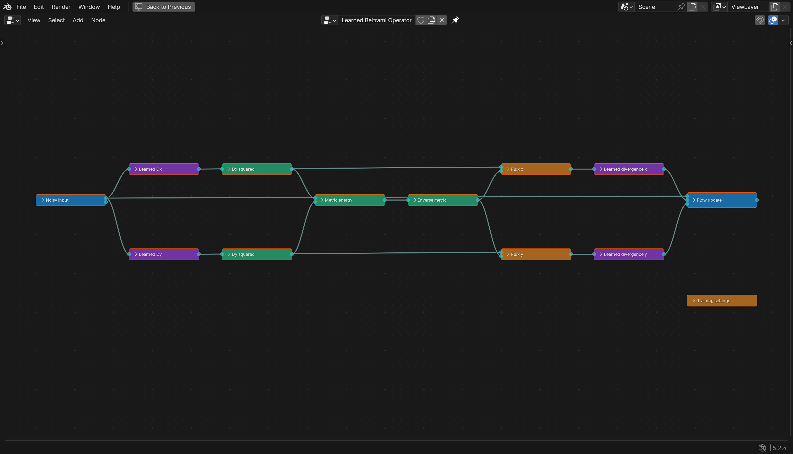

# Blender Neural Composer

[](https://www.blender.org/download/)
[](neural_operator_blender)
[](NOTICE)



Compose neural differential operators with Blender's node editor. This modern continuation of **Caffe-GUI-Tool** recovers the visual network designer used by Aaron Wetzler and Rom Hershkovitz for Deep Patch-Beltrami research.

Drag nodes, edit filter sizes and channel counts, reconnect branches, duplicate stages, and control shared weights. Save a portable JSON graph or export Caffe train/test, deployment and solver definitions. Blender itself needs no Caffe, CUDA, PyTorch or Python package installation.

Tested with **Blender 5.2.4 LTS and 5.1.2** on Apple silicon. The old implementation's property declarations no longer produced editable numerical settings; this version updates them to current Blender RNA APIs while keeping historical node identifiers for old `.blend` files.

## Install

1. Download `blender-neural-composer-1.0.0.zip` from [Releases](https://github.com/twerdster/blender-neural-composer/releases/latest).
2. In Blender, open **Edit → Preferences → Add-ons → Install from Disk…** using the menu at the top right. Select the ZIP and enable **Neural Operator Composer**. Disable the old Caffe Nodes add-on if it is installed.
3. Open the editor-type selector at the left of any editor header and choose **Neural Operator Composer**.
4. Press **N** to show the sidebar. Open **Composer** and choose **Compact Operator Demo** or a recovered Patch-Beltrami network.
5. Use **Add → Neural Operators** to add layers. Expand a collapsed node to edit its settings; normal Blender selection, duplication, movement and linking work as usual.

Build the installable ZIP from a checkout with Python 3:

```bash
python3 tools/build_addon.py
```

The output is `dist/blender-neural-composer-1.0.0.zip`. No dependency installation is required.

## Work with graphs

**Export Neural Graph JSON** saves parameters, shared-weight names, layout, colors, socket names and connections. **Import Neural Graph** restores them. JSON contains data only and does not execute Python. **Validate Graph** detects cycles, missing inputs, duplicate output blobs and invalid names before Caffe export. Malformed JSON links, invalid socket indices and mismatched output names are rejected without keeping a partial graph.

**Export Caffe Solution** writes a deployment network, train/test network, solver and quoted training shell script into the chosen directory. Set the Data node's deployment channels/height/width and data paths, and the Solver node's name and target Caffe executable directory. Exporting writes files; training runs separately in your own Caffe installation. Each Data node supplies the deployment shape for its image outputs, including secondary outputs consumed by inference layers. Use separate Data nodes when inputs need different shapes. The unsupported `multistep` learning-rate schedule is rejected; choose another schedule. Paths and shared-weight names are escaped for protobuf strings. The historical custom **Padding** layer requires the research Caffe fork or an equivalent implementation.

The composer includes 29 node types: convolution/deconvolution, pooling, padding, elementwise arithmetic, powers, exponentials, logs, normalization, activations, fully connected layers, concatenation/slicing, losses, data and solver settings. Learned operators retain explicit derivative, metric, flux, divergence and flow-update structure.

The compact demo illustrates that structure with 16 feature channels and 7×7 learned filters. Its weights are untrained. The recovered graphs preserve historical architecture settings, including intermediate research variants; they are not replacements for the validated final 80-channel checkpoints in [Deep Patch-Beltrami](https://github.com/twerdster/deep-patch-beltrami).

## Recovered research graphs

All six original graphs were opened read-only, converted to portable JSON and checked for exact parameter/layout/socket/link round trips. Machine-specific data and executable paths become editable placeholders. They are bundled in the add-on under `examples/`.

| Original graph | Nodes | Links |
| --- | ---: | ---: |
| Base | 31 | 42 |
| Grayscale | 303 | 442 |
| Multifilter / five stages | 162 | 235 |
| Single grayscale | 30 | 43 |
| Color | 96 | 137 |
| Single color | 38 | 51 |

The Composer sidebar offers the main grayscale, color and five-stage graphs. Import the other JSON files directly. To open your own legacy `.blend` file, enable this add-on **before opening the file** so Blender can resolve its `CaffeNodeTree` and original node types. Save a new copy after checking external data paths.

## Background use and validation

```bash
blender --background --factory-startup --python-exit-code 1 \
  --python tests/blender_test.py
```

This checks every node type's editable RNA settings, exact graph round trips, all example exports, export immutability, invalid graphs/imports and disabling/re-enabling the add-on. Results for both tested Blender versions are in [docs](docs/). Export validation checks graph definitions and generated files; it does not establish that every historical research variant trains or reproduces final denoising metrics in a current Caffe installation.

Example background loading/export:

```python
import neural_operator_blender
from neural_operator_blender import composer, graph
neural_operator_blender.register()
tree = graph.load(composer.EXAMPLES / "patch_beltrami_multifilter.json")
composer.export_caffe(tree, "exports/five-stage")
```

## Origins and citation

The thesis describes the visual editor in §4.5.2 and Figure 4.17, printed pages 63–64, and cites the [2015 Caffe-GUI-Tool](https://github.com/twerdster/caffe-gui-tool). That project is a fork of [H. Tomkins' original](https://github.com/hctomkins/caffe-gui-tool), extended by Aaron Wetzler and Rom Hershkovitz. See [NOTICE](NOTICE) for source provenance and licensing.

```bibtex
@phdthesis{wetzler2017topics,
  author = {Aaron Wetzler},
  title = {Topics in Computational Geometric Vision},
  school = {Technion -- Israel Institute of Technology},
  year = {2017},
  month = {August}
}
```

Modern interface/interchange code is MIT licensed. Adapted historical node/export code and recovered research graphs retain the Unlicense; both texts are included. Blender is distributed separately under its own license.
